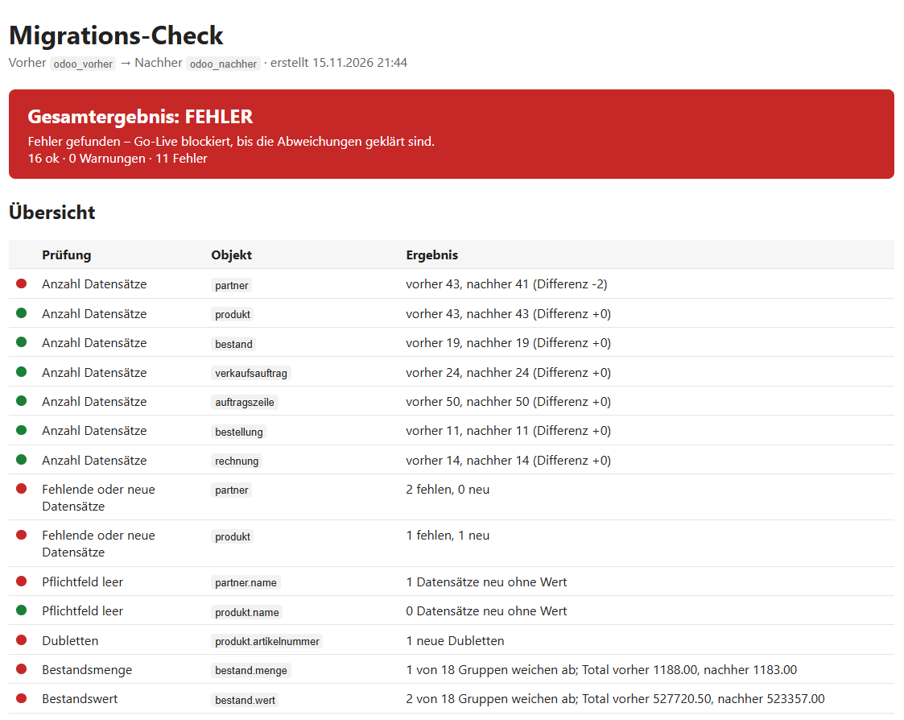

# Migrations-Check

[](https://github.com/alidlaimi/migrations-check/actions/workflows/migrations-check.yml)

Werkzeug, das zwei PostgreSQL-Datenbanken – **vorher** und **nachher** – nach einem
ERP-Upgrade vergleicht und **fachlich relevante Abweichungen** meldet: Stammdaten,
Bestände, offene Belege, referenzielle Integrität und Stichproben. Nicht nur Zeilenzahlen.

Bei Fehlern endet der Check mit Exit-Code ≠ 0 – so kann er in einer Pipeline oder vor
einem Go-Live die Freigabe blockieren.

Getestet an einer **Odoo-Datenbank mit nachgebildetem Upgrade**: Odoo 18 mit Demodaten,
darauf ein eigenes Migrationsskript, das typische Upgrade-Änderungen nachbildet und gezielt
dokumentierte Fehler einbaut.

---

## Warum nicht einfach Zeilen zählen?

Aus dem Beispielbericht – derselbe Lauf, zwei Prüfungen auf dieselben Produkte:

| | Prüfung | Objekt | Ergebnis |
|---|---|---|---|
| 🟢 | Anzahl Datensätze | `produkt` | vorher 43, nachher 43 (Differenz +0) |
| 🔴 | Fehlende oder neue Datensätze | `produkt` | 1 fehlen, 1 neu |

Ein verlorenes Produkt und eine Dublette heben sich in der Zeilenzahl genau auf.
Ein Check, der nur zählt, meldet hier «alles in Ordnung».

Dasselbe gilt für Bestände: 5 Stück weniger bei einem Produkt klingt harmlos –
der Check rechnet es um: **−4'380.00 CHF Bestandswert** in der Bilanz.

## Was geprüft wird

| Bereich | Prüfung | Beispiel für einen Fund |
|---|---|---|
| Stammdaten | Anzahl, fehlende/neue Datensätze, leere Pflichtfelder, Dubletten | Kontakt fehlt; Artikelnummer doppelt; Kundenname leer |
| Bestände | Menge je Produkt und Lagerort, Wert je Produkt, Preise lückenlos | Menge 16 → 11; Einstandspreis 120.50 → 121 |
| Offene Belege | offene Rechnungen, Aufträge, Bestellungen: Anzahl, Status, Summen | Rechnung fälschlich «bezahlt»; Summe +100.00 |
| Integrität | verwaiste Verknüpfungen | Auftragszeile zeigt auf nicht existierendes Produkt |
| Stichproben | zufällige Datensätze Feld für Feld (reproduzierbar) | abweichender Wert in einem Feld ohne eigene Prüfung |

Jede Prüfung hat einen **Schweregrad** (Fehler/Warnung), eine fachlich begründete
**Toleranz** (Stückzahlen exakt, Beträge ±1 Rappen) und eine **Erklärung**, warum eine
Abweichung ein Go-Live blockiert. Alles konfigurierbar in
[`config/pruefungen.yaml`](config/pruefungen.yaml).

## Nachweis: alle Fehler gefunden, keine falschen Alarme

Das Migrationsskript erzeugt zwei Datenbanken:

| Datenbank | Inhalt | Ergebnis des Checks |
|---|---|---|
| `odoo_nachher_sauber` | nur Upgrade-Änderungen | 🟢 OK, Exit-Code 0 – **kein Fehlalarm** |
| `odoo_nachher` | Upgrade + 9 eingebaute Fehler | 🔴 FEHLER, Exit-Code 1 – **alle 9 gefunden** |

| Nr | Eingebauter Fehler | Gefunden durch | |
|---|---|---|---|
| F01 | 2 Kontakte verloren | Fehlende Datensätze `partner` | ✅ |
| F02 | 1 Produkt verloren | Fehlende Datensätze `produkt` | ✅ |
| F03 | Bestandsmenge verändert (16 → 11) | Bestandsmenge, Bestandswert | ✅ |
| F04 | Einstandspreis auf Franken gerundet (3 Produkte) | Preise, Bestandswert, Stichprobe | ✅ |
| F05 | Offene Rechnung mit falscher Summe (+100.00) | Offene Rechnungen | ✅ |
| F06 | Offene Rechnung fälschlich «bezahlt» | Offene Rechnungen | ✅ |
| F07 | Auftragszeile ohne gültiges Produkt | Verwaiste Verknüpfung | ✅ |
| F08 | Produkt-Dublette nach Zusammenlegen der Tabellen | Dubletten | ✅ |
| F09 | Kundenname leer (leerer Text statt NULL) | Pflichtfeld leer | ✅ |

Betroffene Datensätze und die Begründung je Fehler: [`docs/eingebaute-fehler.md`](docs/eingebaute-fehler.md).
Beides prüft die Pipeline bei jedem Push automatisch.

## Beispielbericht



Vollständiger Bericht als Markdown: [`docs/beispielbericht.md`](docs/beispielbericht.md).
Die Pipeline legt bei jedem Lauf beide Berichte (HTML und Markdown) als Artefakt ab.

## Architektur

```
                 config/mapping.yaml          config/pruefungen.yaml
                 (vorher ↔ nachher)           (Regeln, Toleranzen)
                          │                            │
 odoo_vorher  ──┐         ▼                            ▼
                ├──►  fachliche Sicht  ──►  Prüfungen  ──►  Bericht (HTML, Markdown)
 odoo_nachher ──┘   (gleiche Objekte,                  └──►  Exit-Code 0 / 1 / 2
                     Felder, Einheiten)                └──►  Logdatei
```

- **Mapping statt fest verdrahteter Tabellen.** Das Upgrade hat Tabellen umbenannt,
  zusammengelegt, aufgeteilt und Einheiten geändert. `mapping.yaml` übersetzt beide
  Datenbanken in dieselbe fachliche Sicht – erst dann wird verglichen. Sonst wäre jede
  gewollte Änderung ein Fehlalarm.
- **Regeln getrennt von der Logik.** Eine weitere Pflichtfeld-Prüfung sind vier Zeilen YAML,
  kein Code. Ein Fachbereich kann die Regeln lesen und mitbestimmen.
- **Nur lesend.** Der Check öffnet Verbindungen schreibgeschützt.
- **Nur Migrationsfehler melden.** Dubletten oder verwaiste Verweise, die schon vorher
  bestanden, sind kein Fehler der Migration und werden nicht gemeldet.

| Exit-Code | Bedeutung |
|---|---|
| 0 | keine Fehler – Go-Live aus Datensicht freigegeben |
| 1 | Fehler gefunden – Go-Live blockieren |
| 2 | technisches Problem (Aufruf, Konfiguration, Datenbank nicht erreichbar) |

## Testumgebung: nachgebildetes Upgrade

Es handelt sich **nicht** um eine echte Odoo-Versionsmigration, sondern um ein
nachvollziehbares, eigenes Migrationsskript auf einer Odoo-18-Datenbank mit Demodaten:

| Nr | Upgrade-Änderung | Vorher → Nachher |
|---|---|---|
| U1 | Tabelle und Spalte umbenannt | `stock_quant.quantity` → `stock_level.qty_on_hand` |
| U2 | Tabellen zusammengelegt | `product_template` + `product_product` → `product` |
| U3 | Tabelle aufgeteilt | Adressfelder aus `res_partner` → `partner_address` |
| U4 | Datentyp / Einheit geändert | Preis `jsonb` → `numeric`, Gewicht kg → g, Beträge CHF → Rappen |
| U5 | Neues Pflichtfeld mit Standardwert | `product.abc_class` NOT NULL DEFAULT `'C'` |

- [`migration/01_upgrade.sql`](migration/01_upgrade.sql) – Upgrade-Änderungen, in einer Transaktion
- [`migration/02_fehler.sql`](migration/02_fehler.sql) – eingebaute Fehler F01–F09, mit Protokoll
- [`migration/nachher-erstellen.sh`](migration/nachher-erstellen.sh) – erzeugt die nachher-Datenbanken aus dem Abzug

## Installation unter Linux

Getestet unter Ubuntu (WSL2) mit Docker und Python 3.14.

```bash
git clone https://github.com/alidlaimi/migrations-check.git
cd migrations-check

# Zugangsdaten: Vorlage kopieren, Passwort anpassen (.env wird nie committet)
cp .env.example .env

# PostgreSQL starten und warten, bis die Datenbank bereit ist
docker compose up -d --wait db

# vorher-Datenbank aus dem Abzug (Odoo 18, Demodaten) einspielen
docker compose exec -T db createdb -U odoo odoo_vorher
docker compose exec -T db pg_restore -U odoo -d odoo_vorher --no-owner < dumps/odoo_vorher.dump

# nachher-Datenbanken erzeugen: mit eingebauten Fehlern und sauber
./migration/nachher-erstellen.sh
./migration/nachher-erstellen.sh --sauber

# Python-Umgebung
python3 -m venv .venv
source .venv/bin/activate
pip install -r requirements.txt
```

Den Abzug selbst neu erzeugen (statt `dumps/odoo_vorher.dump` zu verwenden):

```bash
docker compose run --rm odoo odoo -d odoo_vorher -i sale_management,purchase,stock --stop-after-init
docker compose exec -T db pg_dump -U odoo -Fc odoo_vorher > dumps/odoo_vorher.dump
```

## Verwendung

```bash
./migrations-check.sh odoo_vorher odoo_nachher          # Bericht in reports/bericht.html
./migrations-check.sh -o reports/sauber odoo_vorher odoo_nachher_sauber
./migrations-check.sh --help
```

Jeder Lauf schreibt eine Logdatei mit Zeitstempel nach `logs/`.

## Tests und Pipeline

```bash
pytest -v
```

- **7 Unit-Tests** prüfen einzelne Prüfungen mit kleinen, von Hand gebauten Daten.
- **13 Integrationstests** lassen Migrationsskripte und Check gegen eine Mini-Datenbank
  ([`tests/testdaten/mini_vorher.sql`](tests/testdaten/mini_vorher.sql)) laufen:
  kein Fehlalarm bei sauberer Migration, jeder Fehler F01–F09 einzeln gefunden.

Die [GitHub-Actions-Pipeline](.github/workflows/migrations-check.yml) führt bei jedem Push
die Tests aus und danach den Beispiel-Lauf auf den Odoo-Demodaten: Die saubere Migration
muss bestehen, die fehlerhafte muss mit Exit-Code 1 blockiert werden.

## Grenzen und nächste Schritte

- **Nachgebildetes Upgrade.** Die Upgrade-Änderungen sind selbst geschrieben, nicht aus einer
  echten Odoo-Versionsmigration. Nächster Schritt: eine echte Migration (z.B. Odoo 17 → 18
  mit OpenUpgrade) prüfen und das Mapping daran anpassen.
- **Daten im Arbeitsspeicher.** Der Check lädt die geprüften Objekte vollständig. Für die
  Demodaten ideal, für Millionen Belege nicht: Dann gehören Summen und Vergleiche als SQL
  in die Datenbank, und nur die Abweichungen kommen zurück.
- **Mapping von Hand.** Das Mapping beschreibt die Upgrade-Änderungen ausdrücklich. Das ist
  gewollt – jede Zuordnung ist nachvollziehbar –, braucht bei einem echten Upgrade aber
  Zeit und Fachwissen.
- **Eine Firma.** Der Einstandspreis wird für Firma 1 gelesen; mehrere Firmen bräuchten eine
  Prüfung je Firma.
- **Weitere Ideen:** relative Toleranzen (z.B. 0.1 % vom Bestandswert), Warnungen für
  fachlich zu beurteilende Fälle, Vergleich mehrerer Probeläufe über die Zeit.

## Projektstruktur

```
migrations-check.sh            Einstieg (Bash): Hilfe, Logdatei, Exit-Codes
migrations_check/              Python-Paket
  check.py                     Ablauf: laden, prüfen
  mapping.py                   baut die SQL-Abfragen aus mapping.yaml
  pruefungen.py                die Prüf-Typen
  bericht.py                   Bericht als Markdown und HTML
  db.py                        Verbindung zu PostgreSQL (nur lesend)
config/
  mapping.yaml                 Zuordnung vorher ↔ nachher
  pruefungen.yaml              Prüfregeln, Toleranzen, Schweregrade
migration/                     nachgebildetes Upgrade und eingebaute Fehler
analyse/datenprofil.sql        Datenprofil vor der Migration
dumps/odoo_vorher.dump         Odoo 18 mit Demodaten (Ausgangszustand)
tests/                         pytest: Unit- und Integrationstests
docs/                          eingebaute Fehler, Beispielbericht
docker-compose.yml             PostgreSQL 16 und Odoo 18
```

## Arbeitsweise

Entstanden Schritt für Schritt mit Unterstützung eines KI-Assistenten (Claude); die
Arbeitsregeln dafür stehen in [`CLAUDE.md`](CLAUDE.md). Fachliche Entscheidungen –
welche Fehler typisch sind, was ein Go-Live blockiert – stammen aus meiner Erfahrung als
Prozessverantwortlicher Wareneingang bei einer Odoo-18-Migration bis zum Go-Live.
